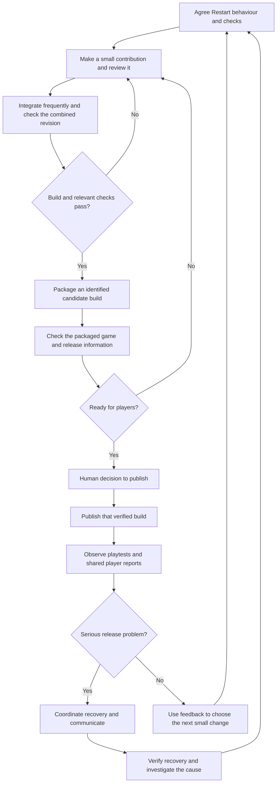

# Lantern Trail DevOps Adoption Plan

An independent case study applying concepts from IBM's [Introduction to DevOps](https://www.coursera.org/learn/intro-to-devops) on Coursera.

Lantern Trail, its team, and the situations below are hypothetical. This analysis establishes a starting scenario for a proposed adoption plan; it does not report an implemented game, actual incidents, or measured improvements.

## Scenario and Player Outcome

Lantern Trail is a small single-player 2D puzzle game for Windows. Players guide a lantern through obstacles to reach an exit. The proposed first playable version contains one short level, movement, one puzzle interaction, an exit, and a Restart action.

The first playable version would test whether players understand the interaction and enjoy solving the puzzle enough to want another level. Observing playtests and discussing player feedback would help the team decide whether to refine the interaction or expand the game. A technically working level alone would not establish that it is enjoyable.

A fictional four-person team collectively covers programming, design, art, testing, and release coordination. Individuals may cover more than one responsibility. The game has no online services: maintaining it means distributing working builds, keeping release information accurate, responding to player reports, and recovering when a published build introduces a serious problem.

For players, the intended outcome is a puzzle they can understand, attempt, and restart reliably. For the team, the delivery challenge is to make useful changes available without losing shared understanding or confidence in the published build.

### Running Example of Restart

After moving puzzle objects into an unsuccessful arrangement, a player selects Restart to try the current level again. The intended behaviour for this case study is that both the player and the puzzle objects return to their starting states for that level.

The current-process example assumes that this expectation was not discussed clearly before coding. A developer interprets Restart as resetting the player's position, while the designer expects the puzzle objects to reset as well. Both interpretations can appear reasonable when the requirement is simply "add Restart."

This difference is a misunderstanding about expected behaviour. A coding defect is different: the team might agree that objects must reset, but the implementation could fail to reset one of them. Both can affect players, but their causes need separate investigation.

## Current Delivery Problems

The scenario assumes four working habits that could delay feedback or make releases less dependable. Their consequences are plausible risks to investigate, not measured findings. The first priority is late testing because it exposes the gap between the team's expectations and the player's ability to retry a puzzle.

### Late Testing and Unclear Expectations

**Current behaviour:** Detailed testing and playtesting occur near release, after most planned changes have been combined. Design, programming, and testing perspectives are not consistently brought together when a feature is first discussed.

**Delivery consequence:** The Restart misunderstanding surfaces late. The team must agree on the expected result, revise the implementation, and check the revised behaviour alongside other accumulated changes. Late discovery leaves less time to make and verify that correction. The release may need to wait; rushing the correction could introduce another defect.

**Player impact:** If the incomplete reset reaches a published build, players could remain stuck with puzzle objects in an unusable arrangement even after restarting. That interrupts experimentation and may make the game feel unfair or unreliable. If the team delays publication instead, players wait longer for the intended update.

**Reasoning:** The issue is not that a particular person failed to "test harder." The process allowed different expectations to remain undiscovered. Later sections will consider how shared examples and earlier verification could address that gap.

### Late Integration of Changes

**Current behaviour:** Developers keep changes separate until several features or fixes are ready, then combine them close to release. Integration means bringing those changes together into a shared version of the game.

**Delivery consequence:** A change to how the level stores puzzle-object positions may not fit the Restart logic developed separately. The combined code might have a visible merge conflict, or it might combine successfully while behaving incorrectly. With several changes arriving together, identifying which interaction caused the problem becomes harder.

**Player impact:** A Restart correction may take longer to reach players while the team investigates integration problems. If an incompatible combination escapes verification, previously working puzzle behaviour could break in the next build.

**Reasoning:** Separate work is not automatically harmful. The concern is the long delay before checking whether the changes work together. The team needs evidence about the combined game, not just confidence in each isolated change.

### Release Knowledge Concentrated in One Person

**Current behaviour:** One team member prepares and publishes builds using steps they remember. Other members cannot readily identify or repeat the complete release process when that person is unavailable.

**Delivery consequence:** Even after the Restart correction has been checked, publication can wait for that person. A remembered step may also be missed, such as confirming that the packaged build contains the intended revision. The team could test one version and accidentally distribute another.

**Player impact:** Players might download a build that still contains the Restart problem or wait unnecessarily for a correction that is otherwise ready. Unclear build information could also make it difficult to tell whether they have the fixed version.

**Reasoning:** Release expertise is valuable. The risk comes from essential knowledge and responsibility being concentrated without a dependable way for others to help. This is a shared delivery concern rather than a reason to blame or remove the release specialist.

### Player Feedback Shared Privately

**Current behaviour:** Players send bug reports directly to the person coordinating releases. The reports are not consistently made available to the rest of the team with the affected build and steps needed to reproduce the problem.

**Delivery consequence:** A report that "Restart does not work" may remain disconnected from the developer and designer who understand the feature. They may receive an incomplete summary later, repeat questions already asked, or investigate a different build. The team loses time connecting the player's experience to a reproducible problem.

**Player impact:** Players may have to explain the same issue more than once or wait longer for a useful response. Without clear acknowledgement or correction information, they may not know whether their report has been understood.

**Reasoning:** Direct contact with a player can be helpful. The delivery problem is that relevant information stays with one person instead of informing the people who can investigate and respond together.

### How the Problems Reinforce One Another

The Restart example illustrates a possible sequence:

```text
Unclear reset expectation
    → misunderstanding discovered during late testing
    → correction meets other changes integrated late
    → checked correction waits for release knowledge
    → player feedback reaches only one person
    → team learning is delayed
```

This sequence is an illustrative explanation, not a record of actual events. It shows why examining the whole delivery process matters: improving one step may leave another source of waiting or lost feedback in place.

## Proposed Shared Ownership and Collaboration

The team would share responsibility for players being able to understand, complete, and restart the puzzle. Completing an individual task would remain useful, but the shared outcome would be a verified change reaching players and the team responding to its consequences.

Shared ownership does not mean everyone performs every job or that nobody is accountable. Each change or reported problem would have a named coordinator who keeps its information current, brings in the relevant expertise, and follows it through. Design, programming, testing, and release responsibilities remain identifiable within the same small team. These are proposed working agreements for the fictional team, not practices already implemented.

### Agree on Behaviour Together Before Coding

For Restart, the person designing the puzzle, the person implementing the change, and someone contributing testing expertise would discuss a concrete example before work begins. They would agree that the player and puzzle objects return to their starting states, identify unclear details, and record the expectation with the change.

This brings testing knowledge into the decision early, addressing late discovery of misunderstandings. Designers clarify player intent; programmers raise implementation questions; testing expertise helps identify observable outcomes and edge cases. One person may cover multiple capabilities. A brief discussion and recorded example are sufficient for this small change; a formal meeting for every edit is unnecessary.

### Make Small Contributions Visible and Review Them

The team would keep the Restart change focused, share it while feedback is still useful, and ask another member to review its behaviour and relevant code before integration. A pull request is a proposed way to keep the change, discussion, and review together. Changes to puzzle-object state would be discussed with the person working on Restart so their assumptions can be checked together.

Smaller contributions give reviewers less unrelated work to understand and can expose incompatible assumptions sooner. The team would also check the combined version; review alone does not establish that integration works. Pairing could help with a difficult reset interaction or knowledge transfer, without requiring two people on every task. Neither review nor pairing guarantees a defect-free release.

### Share Release Knowledge With a Supported Backup

The member with release expertise would document the essential preparation and verification steps, then work through them with a second team member. The record would identify the intended revision, packaged build, checks performed, and published version. Both would update it when the process changes.

For the Restart correction, another member could check that the build intended for players contains the verified fix. This reduces dependence on memory and one person's availability while preserving release expertise. Backup responsibility would include training and appropriate publishing access, rather than assuming an unprepared colleague can release safely. The delivery and recovery workflow below describes how the team would use this shared release knowledge.

### Keep Player Reports Available to the Team

The person receiving a report would capture the affected build, expected and actual behaviour, reproduction steps, and investigation status in a shared issue. They would omit private player contact details from any public record. A named coordinator would arrange investigation, acknowledge the report through the appropriate channel, and track verification of any correction.

For a report that Restart leaves an obstacle in place, the team could reproduce the situation and compare it with the agreed reset behaviour. Shared information reduces repeated handoffs and helps colleagues contribute directly. Direct player conversations can continue, with relevant findings recorded for the team.

### Learn From Problems Without Blame

After a significant release problem, the team would examine what happened, which information or checks were missing, and what small improvement to try. For Restart, the inquiry could reveal an unclear expectation, an interaction missed during integration, or the wrong build being published. These possibilities call for different responses; the team should investigate before choosing one.

A learning approach encourages people to report concerns promptly. It still requires accountability: name a follow-up owner, record the agreed action, and review whether it helped. The team would avoid rewarding only individual task counts or treating testing and releases as someone else's concern. A separate DevOps handoff team would add another boundary without resolving these ownership problems.

### Connections to the Delivery Problems

| Current problem | Proposed practice | Intended effect to assess |
|---|---|---|
| Late testing and unclear expectations | Joint behaviour discussion and early testing input | Discover disagreements before substantial implementation |
| Late integration | Small reviewed contributions, early coordination, and checks of combined changes | Discover incompatible changes earlier |
| Release knowledge concentrated in one person | Maintained release instructions and a trained backup | Reduce waiting and missed preparation steps |
| Player feedback shared privately | Shared issue record with a named coordinator | Make reports actionable and follow-up visible |

These intended effects are hypotheses, not achieved improvements. Concrete examples below show how the team could put earlier feedback into practice.

## Small Batches and Learning Examples

### Small Batches Keep Feedback Close to the Change

A batch is the amount of work accumulated before it is checked or passed to the next stage. For Lantern Trail, a large batch could combine Restart, several new levels, a menu redesign, and new puzzle objects before anyone tries the integrated game. A failure would then have many possible sources.

Instead, the team would take one useful change through discussion, implementation, review, and verification: Restart restores the player and existing movable puzzle objects in the current level. New levels and menu redesign would remain separate. This slice includes the behaviour and the checks needed to assess it; it is not merely a button graphic or an isolated reset function that players cannot use.

The team could review an early contribution before the whole feature is ready, but should distinguish that technical feedback from a usable player-facing increment. Smaller batches do not justify skipping verification or publishing incomplete behaviour. Their intended benefit is less waiting before discovering a problem, not a guaranteed reduction in total effort.

### The MVP Tests the Puzzle's Value

A minimum viable product, or MVP, is the smallest practical experiment that tests a belief about value to users. For this scenario, the hypothesis is: players can understand the central puzzle interaction and enjoy solving it enough to want another level.

The proposed experiment is one playable level with simple visuals, movement, one puzzle interaction, an exit, and reliable Restart. Restart supports repeated attempts; it cannot test the game's value on its own. Extra levels, polished menus, online accounts, and a broad feature set are unnecessary for this first question.

Before the playtest, the team would agree to observe where players need help, whether they can retry without confusion, and whether their actions and comments suggest interest in another puzzle. They would ask what players understood and found frustrating. Finishing the level or saying "yes" to another level would be useful feedback, not conclusive proof of demand.

If players struggle to understand the interaction, the team would revise and test it again rather than immediately adding content. If the experience appears promising, they could continue with another small experiment. No playtest has been conducted and no result is claimed here.

### BDD Makes Restart Expectations Shared and Observable

Behaviour Driven Development, or BDD, starts with a conversation about behaviour that matters to the user. Design, programming, and testing perspectives would clarify what "starting state" includes before implementation. For this first level, the agreed example concerns the player's position and movable puzzle objects' positions; additional state would need explicit discussion if introduced later.

Gherkin expresses the example in a readable Given/When/Then structure:

```gherkin
Scenario: Retry the current puzzle from its starting arrangement
  Given the player has moved from the current level's starting position
    And the player has moved puzzle objects from their starting positions
  When the player selects Restart
  Then the player returns to the current level's starting position
    And each movable puzzle object returns to its starting position
    And the player can attempt the same level again
```

Given describes the starting situation, When identifies the action, and Then describes the expected result. The example exposes the original misunderstanding: resetting only the player would not meet the agreed behaviour. These written criteria are a shared expectation, not evidence of an executed test; automation would require supporting test code.

### TDD Guides One Small Implementation Rule

Test Driven Development, or TDD, uses an executable test to guide implementation through Red, Green, and Refactor. A small rule within Restart could be that resetting a puzzle object restores its saved starting position. The following is a proposed development sequence, not code or a test run performed in this project:

1. **Red:** Write a test that creates an object with a known starting position, moves it elsewhere, invokes its reset behaviour, and checks that its position equals the saved starting position. Run it and confirm that it fails because the required behaviour is missing, rather than because the test setup is broken.
2. **Green:** Implement the smallest change needed to restore that position, then run the test and relevant existing tests. Avoid adding unrelated features to make this one rule pass.
3. **Refactor:** Improve the code's structure if needed without changing its behaviour, then rerun the tests to check that it still works.

Repeat the cycle for the next small rule. A passing object-reset test would not establish that the Restart button resets every object, resets the player, or leaves the level playable. Broader checks against the BDD example would still be needed, and playtesting would assess clarity and enjoyment.

### How the Practices Work Together

| Practice | Lantern Trail application | Feedback it provides |
|---|---|---|
| MVP | Try one playable puzzle before expanding the game | Whether the core experience appears understandable and valuable |
| Small batches | Take the focused Restart feature through review and verification | Whether one useful change works before unrelated work accumulates |
| BDD | Agree that Restart restores the player and puzzle objects | Whether the team shares a testable expectation of player behaviour |
| TDD | Develop an object-reset rule through a failing test, minimal implementation, and refactoring | Whether that specific implementation rule meets its test |

The practices complement one another but answer different questions. None alone guarantees a good game or a safe release. The following workflow connects these practices to delivery and recovery. Measurement definitions and the gradual adoption approach remain to be developed.

## Proposed Delivery and Recovery Workflow

This workflow applies continuous integration and continuous delivery to a downloadable Windows game. It is a proposal, not an implemented pipeline. It does not require a cloud service or a particular automation tool. The team would first make the steps repeatable and then consider automating suitable checks.

### Continuous Integration Checks the Combined Game Early

Continuous integration, or CI, means bringing small changes into the shared code frequently and checking that they work together. For Restart, the developer would share a focused contribution, obtain review, and integrate it without waiting for unrelated levels or menus to be finished. The combined revision would be built and checked promptly. Review and integration checks have different purposes: review examines the proposed change; the checks examine the resulting shared version.

A build failure or failing reset test would be visible to the team and investigated before more work accumulates on top of it. Frequent merging without verification would not solve the late-integration problem. Automated checks could make feedback repeatable, while manual playtesting would still examine whether players can understand and retry the puzzle.

### Continuous Delivery Keeps a Verified Build Ready

Continuous delivery means keeping changes in a state where they can be released reliably when the team chooses. The team would package an identified build, verify that package, and retain the information needed to publish it. A human release decision would consider the checks, known limitations, and player impact.

Continuous deployment goes further by automatically publishing changes that pass the defined gates. It is not proposed for this first adoption step. For Lantern Trail, publishing means making a downloadable build available to players; it does not mean deploying an online game server. A successful source-level test alone would not justify publication.

### Flow From Shared Expectation to Player Feedback



A candidate is a build being considered for release, not a promise that it will be published. A concern at the release decision can lead to more investigation or deferral; it does not require rushing a code change. If the diagram cannot be rendered, its sequence is: agree, review, integrate, check, package, verify, decide, publish, observe, and recover or learn.

### Checks and Responsibilities Before Publication

| Stage | Evidence the team would seek | Follow-through |
|---|---|---|
| Behaviour agreement | Restart example covers the player and movable objects | Change coordinator brings design, programming, and testing perspectives together |
| Integration | Identified shared revision builds and passes relevant tests | Contributor investigates failures with help; the team keeps the result visible |
| Package verification | The packaged game launches, opens the level, and meets the Restart example | Testing contributor records the build identifier and results, including manual checks |
| Release decision | Known limitations reviewed; release information and recovery option understood | Named release coordinator checks readiness with a trained backup |
| Publication and observation | Download points to the intended build; reports identify the affected version | Coordinator verifies availability and keeps follow-up visible to the team |

The packaged-game check matters because an editor or source test can pass while the distributed package is incomplete or contains the wrong revision. The team would keep the source revision, build identifier, check results, and publication record connected. A backup should be able to follow the documented steps rather than depend on the coordinator's memory.

### Hypothetical Restart Failure and Recovery

Assume a published update introduces a defect that leaves one movable obstacle in its moved position after Restart. A player cannot retry the level reliably. This is an imagined incident used to examine the workflow, not an observed failure.

1. **Make the report actionable.** The report coordinator records the affected build, reproduction steps, expected reset, and actual result in the shared issue. Private player contact information stays out of public records. The team confirms the problem in that package and assesses its impact.
2. **Coordinate a response.** The release coordinator and backup identify which download is affected, warn players through the appropriate release channel, and pause promotion of the broken build while recovery is assessed. The issue names who is following the response through.
3. **Check the recovery choice.** The team considers restoring the previous known-good download. They first verify that it launches, supports the affected level, and remains compatible with any settings or saved data involved. Replacing the download does not automatically replace copies players already installed. Players need clear version and installation guidance, including any data precautions.
4. **Restore or correct safely.** If the previous build is suitable, the coordinator makes that verified build available and explains the temporary restoration. If it is incompatible or shares the defect, the team prepares a focused correction through review, integration, packaging, and verification. A prior build is an option, not an assumed safe rollback.
5. **Verify the player-facing result.** A team member obtains the offered download and repeats the failing Restart sequence. The record identifies the recovered build and when it became available. Communication distinguishes availability of a recovery build from confirmation that every player has installed it. The affected artifact and investigation record are retained for diagnosis without promoting it as the recommended download.
6. **Learn and follow up.** The team investigates whether a missing reset rule, an integration interaction, an incomplete test, or a packaging mistake allowed the defect through. They add a regression check for the confirmed cause, verify the correction, and assign ownership for any process improvement. Blameless investigation still requires visible follow-through.

Restoring a usable build addresses immediate player impact; correcting the underlying cause prevents relying indefinitely on restoration. Neither action proves that the adoption plan has improved delivery. No build, automated check, publication, recovery exercise, or elapsed recovery time has been produced or measured in this documentation project.
